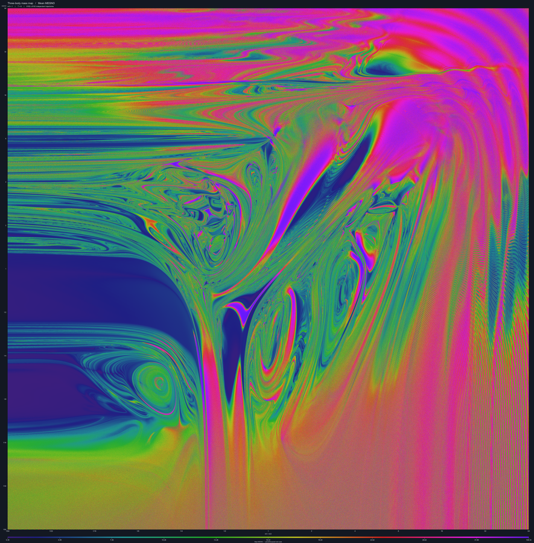
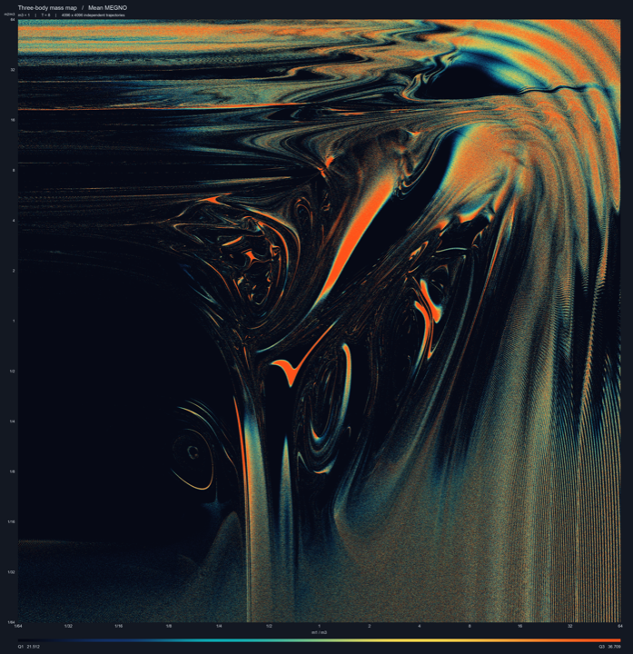

# Chaos: A Three-Body Mass Map

| Blue mass atlas · 8192 × 8192 | Vortex detail · 8192 × 8054 |
| --- | --- |
|  |  |
| **Full spectrum · 8192 × 8192** | **Fixed color scale · 4096 × 4096** |
|  |  |

Each pixel in the map represents an independent three-body experiment. The horizontal axis varies the first body's mass, the vertical axis varies the second, and the third has unit mass. Both axes are logarithmic. As the systems evolve, nearby mass combinations form islands, arcs and fine filaments of differing sensitivity to initial conditions.

The gallery shows previews of tiled offline renders taken at dimensionless time **T = 8**. The three full maps span **1/64–64** on both axes. The vortex is a separately simulated close-up. The interactive shader starts at mass **1** and uses a live quartile color scale.

## Run in VS Code

1. Install the **Shader Studio** extension by **teaqu** in VS Code.
2. Clone the repository and open the cloned folder.

   ```sh
   git clone https://github.com/Zzyyio/mass-chaos.git
   cd mass-chaos
   ```

3. Open **Image.glsl**. Click **Shader Studio** in the status bar and choose **Open Panel**. The adjacent **Image.sha.json** connects the four buffers and the final image.
4. Press Play. The number at the top left is elapsed simulation time. The bar below the mass plane shows the current MEGNO scale.

## Change the simulation

Run the configuration script from the repository folder with Python 3. It uses only the standard library. With no arguments it prints the current settings.

```sh
python3 configure.py
python3 configure.py --help
```

| Option | Checked-in setting | Effect |
| --- | ---: | --- |
| `--grid N` | 512 | Samples per mass axis. A grid of 256 runs 65,536 independent systems. |
| `--substeps N` | 32 | Integration steps per rendered frame. With the default step of 0.001, 32 substeps advance T by 0.032 per update. |
| `--max-mass M` | 4 | Upper endpoint on both axes. Any integer of at least 2 works, including values between powers of two. |

For a lighter preview spanning masses 1–64, run:

```sh
python3 configure.py --grid 128 --substeps 16 --max-mass 64
```

To increase just the sampling density:

```sh
python3 configure.py --grid 256
```

The script keeps omitted settings and synchronizes **Common.glsl** with the texture sizes in **Image.sha.json**. After changing the configuration, reopen the preview and reset playback so every cell starts from the same initial conditions. For comparisons, pause at the same simulation time.

Increasing the grid has a steep cost. Doubling its width quadruples the number of simulations, and the row-ranking pass performs about eight times as many texture reads. Raising substeps adds work per frame, so the actual speedup depends on frame rate.

## Initial conditions and numerical controls

In **BufferA.glsl**, edit the three active `s[0]`, `s[1]` and `s[2]` assignments in the initialization block. Each `vec4(x, y, vx, vy)` gives a body's starting position and velocity. The solver removes center-of-mass motion and rescales time using the total mass. All cells start from the same input positions and velocities.

In **Common.glsl**, `STEP` sets the dimensionless integration step and `EPS` sets the gravitational softening length. To explore masses below 1 like the gallery, edit the lower endpoint of the logarithmic mapping in `massRatio()` and update the matching axis tick positions and labels in **Image.glsl**. The Python command controls the upper endpoint.

## Read the colors

Buffer A integrates the orbits and their tangent perturbation, accumulating time-averaged MEGNO. Buffers B–D find the first and third quartiles of the finite grid values. The image maps the lowest quarter to deep blue and the highest quarter to orange-red, with a continuous gradient between them. A dark patch indicates relatively weak perturbation growth at the displayed time. Assessing long-term stability requires following the indicator over time and checking sensitivity to the integration step.

For the indicator's mathematical definition, see [Cincotta & Simó's original MEGNO paper](https://aas.aanda.org/articles/aas/pdf/2000/20/h1686.pdf).
